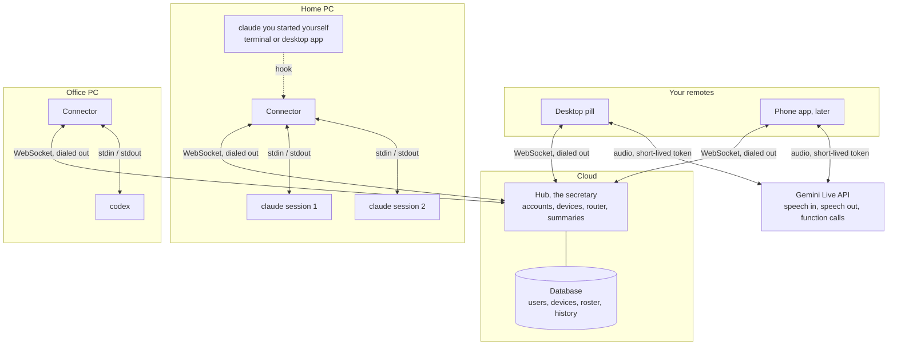
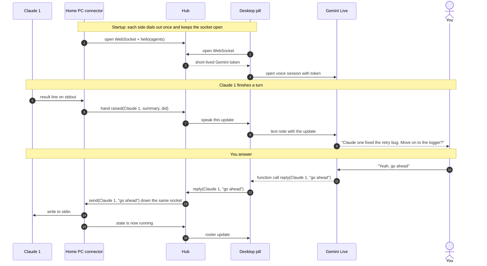

# axo-link architecture

Status: design, October 2026. Phase 1 (the single-machine pill) is the code in
the repo root; everything below is where it is going.

## The idea

A secretary for your coding agents. The agents run on your own machines. A
cloud hub keeps track of them, tells you by voice what they did and when they
need you, and carries your instructions back. You talk to the hub, never to
each agent's window.

## Components

| Piece | Runs on | Job |
|---|---|---|
| Hub | hosted backend | accounts, devices, roster, history, routing, floor rules, the tool API |
| Companion app | each PC | two jobs over one socket to the hub: **connector** (runs or attaches to agent CLIs, reports facts, executes instructions) and **client** (the pill: voice and display) |
| Phone | your phone | client only, no connector |
| Gemini Live | Google | speech in, speech out, understanding via function calls |

A PC can run the companion app connector-only (tray, no pill). Until the hub
is hosted, one companion app runs it in the background; it still connects to
it over a socket like everyone else.

## Connections

- Everything dials out to the hub. Each connector and each client holds one
  WebSocket open; it is two-way, so the hub pushes instructions down it.
  No inbound ports, works behind home and office routers.
- 30s heartbeat keeps routers from dropping idle sockets; connectors redial
  with backoff.
- Offline machine: the hub says so and does not queue the instruction, so a
  stale "go ahead" never fires hours later.

## Round trip

## Two kinds of session

| | Spawned by the connector | Attached via hooks |
|---|---|---|
| How | connector runs the CLI, drives stdin/stdout | Claude Code hook script reports to the connector |
| Knows when it's waiting | yes | yes |
| Approve / deny | yes | yes (permission hook) |
| Reply | yes | short answers only (Stop hook, within its timeout) |
| Start new work | yes | no |

Codex: spawned works; attached is notify-only (`notify` in `config.toml`).

## What the secretary can do

The hub owns this list and hands it to Gemini as function declarations.
A new capability is a new tool. Voice and a future text box share the same
tools.

| Tool | You say |
|---|---|
| `briefing(since)` | "What did I miss?" |
| `status(agent)` | "What's Claude two doing?" |
| `reply(agent, text)` | "Claude one, go ahead with the logger" |
| `approve(agent)` / `deny(agent)` | "Yes, let it" / "No" |
| `start_agent(machine, project, task)` | "Start a Claude on axo-link and fix the stop bug" |
| `stop(agent)` | "Stop Claude two" |
| `notify_when(agent, condition)` | "Tell me when Claude two is done" |
| `set_focus(mode)` | "I'm driving, only approvals" |
| `handoff(from, to, instruction)` | "Have Codex research pooling and send it to Claude one" (later) |

`start_agent` only accepts projects registered on that machine, never a path
spoken aloud.

Built so far: `agents` (covers briefing and status), `reply`, `approve`,
`deny`, `stop`, `set_mode`. The rest wait on the hub keeping history
(`briefing since`, `notify_when`) and on registered projects (`start_agent`).

## The PC pill

Wispr Flow's interaction, pointed at agents as well as text fields.

- A thin bar at the bottom centre. Amber when an agent is waiting. Hover or
  click opens the roster upward. The window never takes focus, and clicks
  outside the pill pass through.
- Hold `Ctrl`+`Win` to dictate into the focused app (Wispr's default). Add
  `Alt` to talk to axo instead. Tap to go hands-free. Both chords are set in
  the pill's Settings.
- Desk mode: an agent finishing is a chime and the amber bar; axo speaks only
  when you hold the key. Away mode: axo says each update as it happens. Set in
  Settings, or by telling axo "I'm driving".
- Dictation: `gemini-3.5-transcribe-live`, typed in via the clipboard and
  Ctrl+V, clipboard restored after. axo: `gemini-3.8-live` with the tools
  above. Both open with one-use tokens from the hub; the hub picks the model.

## Trust boundaries

- Code and CLI logins never leave the user's machine.
- The hub sees summaries, tool names, and commands awaiting approval.
- The Gemini key stays on the hub; clients get short-lived tokens.
- Destructive actions are read back and need an explicit yes.
- Every device token is revocable.

## Build order

1. ~~Hub, connector and pill for one user, hub running locally. Fixes from
   Phase 1 first: blocking approvals, Stop that stops, dead sessions shown dead.~~
2. ~~Wispr-style pill, dictation, voice via Gemini Live with short-lived tokens.~~
3. Hooks, so terminal and desktop-app Claude sessions join the roster.
4. Hub on a small cloud host; sign-in and device pairing.
5. Multi-user hardening and billing.

## Open decisions

- Who pays for Gemini: bundled, or bring your own key.
- Single user first, or public soon.
- Check Anthropic and OpenAI terms on third-party products driving their CLIs.
