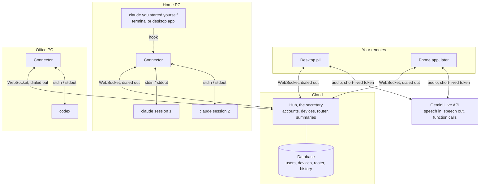
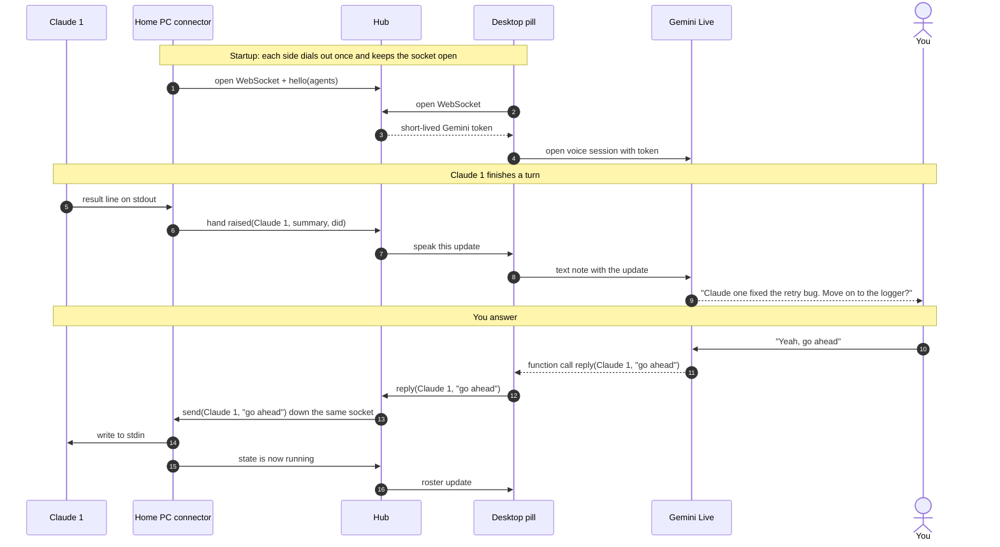

# axo-link architecture

Status: October 2026. Built (branch `phase-2-hub-and-voice`): hub, connector,
Wispr-style pill, dictation, axo's voice. Next: axo as the secretary over your
Claude terminal sessions -- see [Next](#next-axo-as-the-secretary-over-claude-terminal-sessions).

## The idea

A secretary for your coding agents. **axo is the secretary; each agent
session is an employee.** You ask axo who's working and on what, pick one, see
exactly what it has done, give it instructions, and switch to another
whenever you like -- by voice, at the desk or away.

The agents run on your own machines. A hub keeps track of them, tells you
what they did and when they need you, and carries your instructions back.

## Components

| Piece | Runs on | Job |
|---|---|---|
| Hub | hosted backend | accounts, devices, roster, history, routing, floor rules, the tool API |
| Companion app | each PC | two jobs over one socket to the hub: **connector** (runs or attaches to agent CLIs, reports facts, executes instructions) and **client** (the pill: voice and display) |
| Phone | your phone | client only, no connector |
| Gemini Live | Google | speech in, speech out, understanding via function calls |

A PC can run the companion app connector-only (tray, no pill). Until the hub
is hosted, one companion app runs it in the background; it still connects to
it over a socket like everyone else.

## Connections

- Everything dials out to the hub. Each connector and each client holds one
  WebSocket open; it is two-way, so the hub pushes instructions down it.
  No inbound ports, works behind home and office routers.
- 30s heartbeat keeps routers from dropping idle sockets; connectors redial
  with backoff.
- Offline machine: the hub says so and does not queue the instruction, so a
  stale "go ahead" never fires hours later.

## Round trip

## Three kinds of session

| | Spawned (`+` in the pill) | Launched (`axo` in a terminal) | Attached (plain `claude`, desktop app) |
|---|---|---|---|
| How | connector runs `claude -p`, drives stdin/stdout | launcher runs the real Claude TUI in a pseudo-terminal the companion app can type into | Claude Code hooks report to the connector |
| Has a window | no, the pill is its window | yes, your terminal | yes, its own |
| Knows when it's waiting | yes | yes (hooks) | yes (hooks) |
| Talk to it any time | yes | yes | no: only when it pauses, in away mode; or "bring it in" |
| Approve / deny | yes | in its terminal for now (see below) | yes, while the hook is held |
| Built | yes | yes | after |

Answering a launched session's permission prompt from axo is open. The
documented route is the PermissionRequest hook returning a decision, but the
docs don't say whether the prompt still shows in the terminal while the hook
holds its answer -- and if it doesn't, the person at the desk would be locked
out until axo decides. Settle that with one live test before building it.

Codex: spawned works; attached is notify-only (`notify` in `config.toml`).

## What the secretary can do

The hub owns this list and hands it to Gemini as function declarations.
A new capability is a new tool. Voice and a future text box share the same
tools.

| Tool | You say |
|---|---|
| `briefing(since)` | "What did I miss?" |
| `status(agent)` | "What's Claude two doing?" |
| `reply(agent, text)` | "Claude one, go ahead with the logger" |
| `approve(agent)` / `deny(agent)` | "Yes, let it" / "No" |
| `start_agent(machine, project, task)` | "Start a Claude on axo-link and fix the stop bug" |
| `stop(agent)` | "Stop Claude two" |
| `notify_when(agent, condition)` | "Tell me when Claude two is done" |
| `set_focus(mode)` | "I'm driving, only approvals" |
| `handoff(from, to, instruction)` | "Have Codex research pooling and send it to Claude one" (later) |

`start_agent` only accepts projects registered on that machine, never a path
spoken aloud.

Built so far: `agents` (covers briefing and status), `reply`, `approve`,
`deny`, `stop`, `set_mode`. The rest wait on the hub keeping history
(`briefing since`, `notify_when`) and on registered projects (`start_agent`).

## Next: axo as the secretary over Claude terminal sessions

Starting with Claude Code in the terminal. One rule: **start sessions with
`axo claude` instead of `claude`** -- a deliberate choice each time, no alias
(and room for `axo codex` later). `axo claude` runs the real Claude Code in your terminal
-- it looks and works exactly the same -- with the companion app sitting
invisibly in between, so it can type into that terminal and knows the
session's id and folder from the start.

What it sounds like:

> **You:** Hey axo, which sessions are running?
> **axo:** Three. deskill is running tests, axo-link has been idle ten minutes, docs is waiting on an approval.
> **You:** Let's talk to deskill. What exactly did it do?
> **axo:** It edited fetch.js and retry.js, created a timeout test, and ran npm test, which passed.
> **You:** Tell it to also add a test for the slow-network case.
> **axo:** Sent. *(It appears in deskill's terminal as if you'd typed it.)*
> **You:** Switch to docs. Read me its last message.

How each part works:

1. **The session list** lives in the companion app. Launched sessions register
   themselves; Claude Code hooks report each one's state (working, done,
   waiting on you).
2. **Talking to a session** types your words into its terminal. axo stays in
   the middle (decided): it passes your words on and tells you when the
   session answers -- no direct line.
3. **Switching** moves where your words go: "switch to docs".
4. **Knowing what it did -- exactly, never axo's paraphrase.** Claude Code saves
   every session's full history on the PC; everything below is read from it.

| You say | You get | Built from |
|---|---|---|
| "Read me its last message" | Claude's own words, word for word | the Stop hook's `last_assistant_message`, read by `gemini-3.8-flash-lite-tts` in axo's voice, a part at a time (first sentence alone so it starts in ~4 s). Built. Paid tier: the free one allows 10 speech requests a day |
| "What exactly did it do?" | every action in order: each file edited (path), each command run (exact command, pass or fail) | the history file, parsed locally -- no AI in between |
| "Show me" / "what changed?" | the session's terminal comes forward, or its full history opens in the pill; the code changes as a diff | the launcher knows its window; git for the diff |

**Summaries come from the session itself.** axo never summarises a history.
For a summary you ask the session -- "deskill, sum up what you've done" -- which
knows its own work best, at the cost of one of its turns. So no session history
is sent to Gemini to be summarised.

**Sessions started with plain `claude`** are listed too (from their saved
history and hooks), and their action log and last message can be read out.
To talk to one: "bring in deskill" -- axo reopens it under `axo` in a new
terminal, continuing where it left off, and you close the old window. Two
processes must never drive one session at once.

Voice tools this adds: `sessions`, `talk_to(session)`, `say(text)`,
`last_message(session)`, `actions(session)`, `show(session)`,
`bring_in(session)`.

## The PC pill

Wispr Flow's interaction, pointed at agents as well as text fields.

- A thin bar at the bottom centre. Amber when an agent is waiting. Hover or
  click opens the roster upward. The window never takes focus, and clicks
  outside the pill pass through.
- Hold `Ctrl`+`Win` to dictate into the focused app (Wispr's default). Add
  `Alt` to talk to axo instead. Tap to go hands-free. Both chords are set in
  the pill's Settings.
- Desk mode: an agent finishing is a chime and the amber bar; axo speaks only
  when you hold the key. Away mode: axo says each update as it happens. Set in
  Settings, or by telling axo "I'm driving".
- Dictation: `gemini-3.5-transcribe-live`, then a Wispr-style clean-up on the
  hub with `gemini-3.5-flash-lite` (~1 s; raw words if it fails, takes over
  3 s, or looks like an answer), typed in via the clipboard and Ctrl+V,
  clipboard restored after. axo: `gemini-3.8-live` with the tools
  above. Both open with one-use tokens from the hub; the hub picks the model.

## Trust boundaries

- CLI logins never leave the user's machine.
- The hub sees each agent's folder path, its last message in full, tool names
  and commands awaiting approval -- more than summaries, and the last message
  can quote code. That message also reaches Gemini. Trim this to an explicit
  outbound projection before the hub is hosted.
- The Gemini key stays on the hub; clients get short-lived tokens.
- Every connection needs the hub token, localhost included; connections from
  browsers (anything sending an Origin header) are refused. Malformed messages
  and agent records are dropped.
- Approvals name the exact request ids they were shown; if the agent's
  requests changed since, nothing is approved. Commands are shown and read out
  in full, never truncated.
- Every device token is revocable. (Not yet: today it's one shared token.)

## Build order

1. ~~Hub, connector and pill for one user, hub running locally. Fixes from
   Phase 1 first: blocking approvals, Stop that stops, dead sessions shown dead.~~
2. ~~Wispr-style pill, dictation, voice via Gemini Live with short-lived tokens.~~
3. axo as the secretary over Claude terminal sessions (see Next):
   1. ~~the `axo claude` launcher and the session list~~ (the launcher is a
      connector with one agent: it dials the hub with the token the app
      leaves in `hub.json` in its app-data folder, and the hub routes that
      session's instructions straight to it);
   2. ~~hooks for each session's state~~ (plus the gaps after: failed turns,
      Esc noticed, no typing over a half-typed line or a permission prompt,
      multi-line, keys for menus, instructions answered with done or why not);
   3. reading the history: last message, action log, diff;
   4. the voice tools, talking and switching;
   5. "bring in" for plain `claude` sessions.
4. Hooks for desktop-app sessions: listed, read, answered when they pause.
5. Hub on a small cloud host; sign-in and device pairing.
6. Multi-user hardening and billing.

## Open decisions

- Who pays for Gemini: bundled, or bring your own key.
- Single user first, or public soon.
- Check Anthropic and OpenAI terms on third-party products driving their CLIs.
